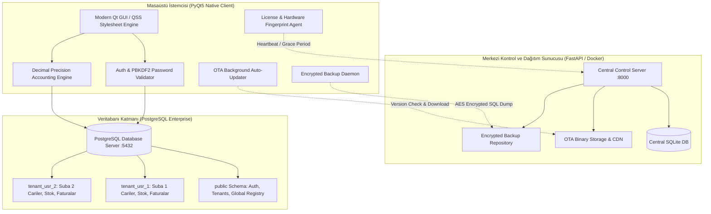

# 🐝 Arı Fırın ERP - Dağıtık Çok Şubeli Fırın & Muhasebe Yönetim Sistemi
> **Enterprise Multi-Branch Bakery Management, Production Dispatch & Accounting ERP Ecosystem**

[](https://www.python.org/)
[](https://riverbankcomputing.com/software/pyqt/)
[](https://www.postgresql.org/)
[](https://fastapi.tiangolo.com/)
[]()
[]()

---

## 📌 Genel Bakış (Overview)

**Arı Fırın ERP**, unlu mamul üreticileri, pastaneler ve çok şubeli perakende zincirleri için sahada aktif olarak kullanılan **üretimden kasaya uçtan uca kurumsal kaynak planlama (ERP) ve muhasebe** yazılımıdır.

Geleneksel muhasebe yazılımlarının hantal yapılarına karşın; fırıncılık sektörünün yüksek işlem hacmi, günlük fire dinamikleri, imalathane-şube sevkiyat trafiği ve kesintisiz çalışma (çevrimdışı tolerans) gereksinimleri gözetilerek **yüksek performanslı, modüler ve güvenli** bir mimari ile sıfırdan inşa edilmiştir.

---

## 🏛️ Mimari ve Mühendislik Yetkinlikleri (Engineering Highlights)

### 1. PostgreSQL Multi-Tenant Dinamik Şema İzolasyonu
- Her müşteri veya franchise kümesi için veritabanı seviyesinde bağımsız şemalar (`tenant_usr_X`) dinamik olarak oluşturulur.
- Ortak tablolar (`public.users`, `public.tenants`) ile şube verileri (`Customers`, `Invoices`, `Stock`, `Turnover`) mantıksal ve fiziksel olarak ayrıştırılarak **tam veri gizliliği** ve **yüksek sorgu performansı** sağlanır.
- Otomatik şema versiyonlama ve dinamik bağlantı havuzu (connection pooling) ile kaynak tüketimi optimize edilir.

### 2. Yüksek Hassasiyetli Finansal Hesaplama Motoru (FinTech Standardı)
- Kayan nokta (floating point) hesaplamalarından kaynaklanan kuruş sapmalarını ve yuvarlama hatalarını önlemek adına Python standardı `Decimal` ve **Banker's Rounding (`ROUND_HALF_EVEN`)** algoritması kullanılmıştır.
- KDV tevkifatı, iskonto kademeleri ve cari bakiye yaşlandırma işlemleri mikron seviyesinde finansal doğrulukla yürütülür.

### 3. OTA (Over-The-Air) Otomatik Güncelleme ve Sürüm Dağıtımı
- Sahadaki istemciler, merkezi kontrol sunucusu (`central_server`) ile periyodik olarak haberleşir.
- Yeni bir sürüm yayınlandığında arka planda SHA-256 doğrulama ile paket indirilir, kullanıcıya modern bildirim şeridi sunulur ve uygulama kapatıldığında kesintisiz binary takası (in-place replacement) gerçekleştirilir.

### 4. Çevrimdışı Dayanıklılık ve Donanım Tabanlı Lisanslama
- Donanım parmak izi (UUID, CPU ve anakart seri numarası) üzerinden makine kimliği doğrulaması yapılır.
- Ağ kesintilerinde iş akışının aksamaması için **7 günlük çevrimdışı tolerans (offline grace period)** devrededir.
- Güvenlik ihlallerinde sunucu üzerinden anlık uzaktan askıya alma (**remote kill-switch**) desteği mevcuttur.

### 5. Kriptolu Otomatik Bulut Yedekleme ve Felaket Kurtarma
- Arka plan iş parçacığında (background daemon thread) çalışan zamanlayıcı, veritabanı dump'larını periyodik olarak alır, şifreler ve merkezi kontrol sunucusuna otomatik olarak yükler.
- Eski yedeklerin otomatik rotasyonu (retention policy) ile depolama alanı verimli yönetilir.

### 6. Kurumsal Seviye Güvenlik (Enterprise Security)
- **Şifreleme:** `PBKDF2-HMAC-SHA256` (100.000 iterasyon) tuzlu (salted) hash'leme.
- **Zamanlama Saldırısı Koruması:** `hmac.compare_digest` ile sabit zamanlı doğrulama.
- **SQL Enjeksiyon Koruması:** Tüm veritabanı katmanında %100 parametreli sorgular ve şema adı beyaz liste (whitelist) doğrulaması.
- **Gizli Bilgi Yönetimi:** Kod tabanında sıfır sabit şifre/IP; çevre değişkenleri (`.env`) ve güvenli yapılandırma şablonları (`config.example.json`).

---

## 📐 Sistem Mimarisi (System Design)



---

## 📦 Temel Modüller ve Yetenekler (Core Modules)

| Modül | Açıklama & Temel Fonksiyonlar |
| :--- | :--- |
| 🏭 **İmalathane & Sevkiyat Hub** | Günlük üretim reçeteleri, parti (batch) takibi, un/hammadde sarfiyatı ve şubelere otomatik irsaliyeli ürün sevkiyatı. |
| 📊 **Günlük Kasa & Ciro** | Nakit, kredi kartı, banka havalesi, veresiye (açık hesap) tahsilatları, gider düşümleri ve gün sonu Z-rapor mutabakatı. |
| 📦 **Stok & Fire Yönetimi** | Tarih bazlı dinamik stok sayımı, sayım farkı (açık/fazla) tespiti, otomatik fire maliyeti hesaplama ve Excel raporlama. |
| 🧾 **Fatura & Cari Hesap** | Alış/satış faturaları, KDV tevkifatı, cari bakiye yaşlandırma, hesap ekstresi ve PDF/Excel çıktı desteği. |
| 🏢 **Şirket Giderleri & Banka** | Gider kategorizasyonu, çek/senet takibi, çoklu banka hesap bakiyeleri ve nakit akış projeksiyonu. |
| 👥 **Personel & Maaş** | Avans, maaş hakedişleri, mesai takibi ve personel bazlı harcama yönetimi. |
| 🛡️ **Yönetici Denetim Paneli** | Sistem geneli canlı kullanıcı oturumu takibi, bağlantı sıhhat testi ve yetki seviyesi yönetimi. |

---

## 💻 Teknoloji Yığını (Tech Stack)

- **Masaüstü Kullanıcı Arayüzü:** Python 3.12, PyQt5, Modern QSS (Responsive UI, High-DPI uyumlu)
- **Veritabanı Motoru:** PostgreSQL 14+, Dinamik Multi-Tenant Şemalar, `psycopg2`
- **Merkezi Dağıtım & OTA Sunucusu:** FastAPI, Uvicorn, SQLite, Jinja2, Docker
- **Veri İşleme & Raporlama:** Pandas, OpenPyXL, ReportLab
- **Güvenlik & Kriptografi:** PBKDF2-HMAC-SHA256, HMAC, Secrets, Zipfile AES şifreleme
- **Paketleme & Dağıtım:** PyInstaller (Standalone PE), Inno Setup 6 (Windows Kurulum Sihirbazı)

---

## 📁 Proje Dizin Yapısı (Project Structure)

```text
Arı_Fırın/
├── main.py                     # İstemci masaüstü uygulaması ana giriş noktası
├── admin_panel.py              # Bağımsız yönetici ve denetim paneli
├── ari_firin.spec              # PyInstaller derleme konfigürasyonu
├── build_app.py                # Otomatik masaüstü PE derleme aracı
├── setup.iss                   # Inno Setup 6 kurulum paketi betiği
├── version.txt                 # Güncel üretim sürüm bilgisi (1.0.5)
├── config.example.json         # Yapılandırma şablonu (şifresiz/güvenli)
├── .env.example                # Çevre değişkenleri şablonu
├── requirements.txt            # İstemci Python bağımlılıkları
│
├── central_server/             # Merkezi OTA, Lisans ve Bulut Yedekleme Sunucusu
│   ├── main.py                 # FastAPI API uç noktaları ve yönetim arayüzü
│   ├── database.py             # SQLite lisans ve proje kayıt katmanı
│   ├── Dockerfile              # Container dağıtım konfigürasyonu
│   ├── docker-compose.yml      # Canlı sunucu orkestrasyonu
│   └── templates/              # Web yönetim şablonları
│
├── src/                        # İstemci Uygulama Çekirdeği
│   ├── core/                   # Yapılandırma, veritabanı havuzu, logger, versiyon
│   │   ├── config.py           # Güvenli konfigürasyon yöneticisi
│   │   ├── database.py         # PostgreSQL multi-tenant havuz ve migration
│   │   ├── decimal_utils.py    # Finansal kuruş ve banker yuvarlama motoru
│   │   └── version.py          # Dinamik sürüm çözümleme katmanı
│   │
│   ├── models/                 # Veritabanı domain modelleri
│   │   ├── branch.py           # Şube veri modeli
│   │   ├── customer.py         # Cari hesap modeli
│   │   ├── invoice.py          # Fatura ve fatura satırı modeli
│   │   ├── journal.py          # Muhasebe yevmiye kayıtları
│   │   └── user.py             # PBKDF2 oturum ve kullanıcı modeli
│   │
│   ├── services/               # İş mantığı servisleri (Business Logic)
│   │   ├── turnover_service.py # Günlük ciro ve kasa servisi
│   │   ├── production_service.py# İmalat ve sevkiyat transfer servisi
│   │   ├── stock_count_service.py# Stok sayım ve fire servisi
│   │   ├── invoice_service.py  # Fatura kesim ve bakiye servisi
│   │   └── updater_service.py  # OTA arka plan indirme servisi
│   │
│   ├── ui/                     # PyQt5 Grafiksel Kullanıcı Arayüzü
│   │   ├── main_window.py      # Ana uygulama kabuğu ve modül yönlendirici
│   │   ├── branch_select.py    # Şube seçim diyaloğu
│   │   ├── pages/              # Alt modül sayfaları (Ciro, İmalat, Stok vb.)
│   │   └── styles.py           # Kurumsal modern QSS tema tanımları
│   │
│   └── utils/                  # Yardımcı araçlar ve arka plan servisleri
│       ├── auto_updater.py     # Binary takas ve OTA yürütücüsü
│       ├── backup_scheduler.py # Şifreli yedekleme arka plan iş parçacığı
│       └── license_manager.py  # Makine parmak izi ve lisans yöneticisi
│
├── resources/                  # Uygulama ikonları, logolar ve statik varlıklar
│   └── icons/                  # Çok çözünürlüklü Windows ICO ve PNG simgeleri
│
├── docs/                       # Teknik Belgeler ve Canlıya Alma Rehberleri
│   ├── CANLIYA_ALMA_VE_DAGITIM_REHBERI.md
│   └── GELISTIRICI_VE_SURUM_YONETIMI_REHBERI.md
│
└── scripts/                    # Operasyonel ve derleme yardımcı betikleri
    ├── build_executables.py    # Otomatik PyInstaller derleyici
    ├── build_installer.py      # Inno Setup & ZIP dağıtım paketleyici
    └── generate_app_icons.py   # Çok çözünürlüklü ICO simge üreteci
```

---

## 🚀 Kurulum ve Yerel Geliştirme (Getting Started)

### 1. Gereksinimler
- Python 3.10+ (Önerilen: Python 3.12 64-bit)
- PostgreSQL 14 veya üzeri
- Windows 10 / 11 (Masaüstü istemcisi için)

### 2. Depoyu Klonlama ve Sanal Ortam Kurulumu
```bash
git clone https://github.com/sunasolmaz/Ari_Firin.git
cd Ari_Firin

python -m venv venv
venv\Scripts\activate  # Windows
# source venv/bin/activate  # Linux/macOS

pip install -r requirements.txt
```

### 3. Ortam Değişkenleri ve Konfigürasyon
1. `.env.example` dosyasını `.env` olarak kopyalayın:
   ```bash
   cp .env.example .env
   ```
2. Veritabanı ve sunucu bilgilerinizi `.env` içerisine tanımlayın:
   ```env
   DB_HOST=localhost
   DB_PORT=5432
   DB_NAME=accounting_db
   DB_USER=postgres
   DB_PASSWORD=guclu_veritabani_sifreniz
   APP_VERSION=1.0.5
   ```

### 4. Uygulamayı Başlatma
```bash
python main.py
```
*(İlk çalıştırmada veritabanı şeması ve tabloları otomatik olarak oluşturulur).*

### 5. Merkezi OTA ve Lisans Sunucusunu Başlatma (İsteğe Bağlı)
```bash
cd central_server
pip install -r requirements.txt
uvicorn main:app --host 0.0.0.0 --port 8000 --reload
```

---

## 🛠️ Derleme ve Dağıtım Pipeline (Build & Packaging)

Proje, son kullanıcı bilgisayarlarına Python kurulu olmaksızın çalışabilen **bağımsız Windows PE (.exe)** formatında paketlenir.

### 1. PyInstaller ile Standalone EXE Derleme
```powershell
pyinstaller --noconfirm --clean ari_firin.spec
```
Veya dahili derleme aracı ile:
```powershell
python build_app.py
```
Çıktı `dist/AriFirin/` dizininde üretilir.

### 2. Inno Setup ile Windows Kurulum Paketi Üretme
Inno Setup 6 kurulu bir sistemde:
```powershell
iscc setup.iss
```
`dist/AriFirin_Setup_v1.0.5.exe` tek tıkla kurulan, masaüstü kısayollarını ve kaldırma aracını içeren kurulum paketi üretilir.

---

## 🔒 Güvenlik Politikası ve Açıklık Bildirimi

- Bu depodaki tüm şablon ve örnek konfigürasyon dosyaları gerçek kimlik bilgileri, IP adresleri ve API anahtarlarından arındırılmıştır.
- Canlı ortamlarda çevre değişkenleri (`.env`) ve işletim sistemi gizli anahtar depoları kullanılmaktadır.
- Güvenlik açığı bildirimleri için GitHub Issues sekmesini kullanabilirsiniz.

---

## 📄 Lisans ve Telif Hakkı

Tüm hakları saklıdır. Bu proje, kurumsal portfolyo ve mimari vitrini amacıyla yayınlanmıştır.
Proje Geliştiricisi: **Suna Solmaz**
